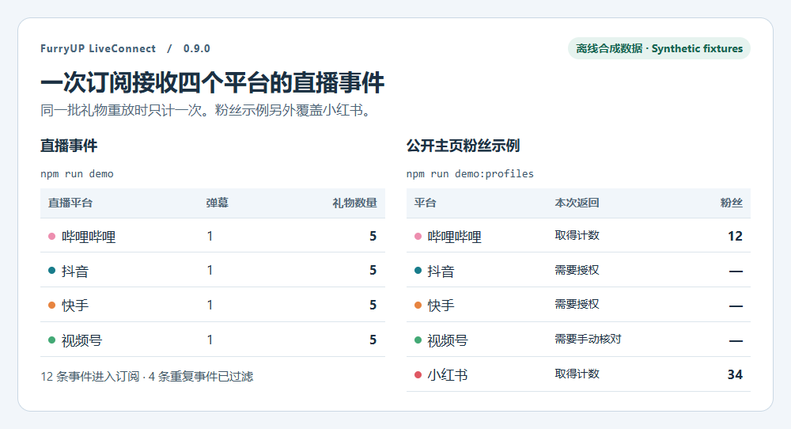
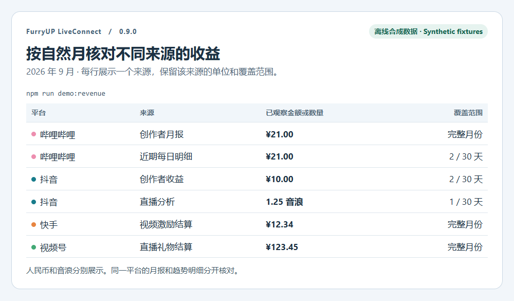
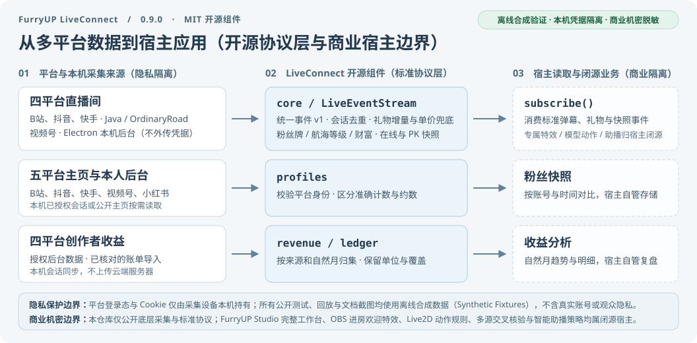

# FurryUP LiveConnect

**Multi-platform livestream and creator data for Node.js and Electron.** Subscribe to live events, compare follower snapshots, or build a calendar-month income view. LiveConnect covers five platforms. Its three modules can be integrated independently under the MIT license.

[中文](README.md) · [Offline demo](#try-the-offline-demo) · [Developer API](docs/API.md) · [FurryUP Studio downloads](https://github.com/frostynight-furry/furryup-studio-releases)

## Platform coverage

| Platform | Live events | Profiles and followers | Creator revenue |
| --- | --- | --- | --- |
| Bilibili | Java collector | Creator session or opt-in public profile | Monthly reports and recent daily data |
| Douyin | Java collector | Creator session or configured profile reader | Creator income and anchor analytics. Wallet verification is separate. |
| Kuaishou | Java collector | Creator session or authorized API | Video incentive settlements and live trends |
| WeChat Channels | Authorized Electron live dashboard | Creator session | Account overview and eligible live settlements |
| Xiaohongshu | — | Public profile and creator-session adapters. Real-account collection awaits verification. | — |

The source on this branch is **0.9.1**. The three Java collectors reuse OrdinaryRoad 1.5.8. Channels uses a local authorized Electron session. Follower snapshots distinguish exact and rounded counts. Revenue keeps missing periods, balances, lifetime amounts and platform-native units distinct. [Follower adapters](docs/CREATOR_FOLLOWERS.en.md) · [Revenue](docs/CREATOR_REVENUE.en.md) · [Automatic sync](docs/REVENUE_SYNC.en.md) · [Douyin wallet](docs/DOUYIN_WALLET.en.md) · [Tagged source](https://github.com/frostynight-furry/furryup-live-connect/releases)

## See the results

These screenshots arrange the bundled demos' output alongside the 0.9.1 protocol enhancements by platform. Four synthetic rooms produce 12 accepted events with four duplicate deliveries filtered, while highlighting normalized guard/wealth/fan badge levels, gift unit-price fallback and online viewer snapshots. The public profile demo returns explicit authorization or manual states. All visuals use `synthetic-*` fixtures with zero real accounts or audience records. [Event demo](examples/offline-demo.cjs) · [Profile demo](examples/profile-demo.cjs)



In the revenue fixture, Bilibili's full monthly report and its two observed trend days have different coverage. Douyin's CNY values and its native live engagement unit have separate series, illustrating the open-source ledger structure without real creator statements or proprietary revenue rules. [Revenue demo](examples/revenue-demo.cjs)



## Architecture and privacy/commercial boundary

The three Java platforms and the Channels Electron collector feed the `core` event subscription. The `profiles` module verifies account identity and returns follower snapshots. The `revenue` module normalizes period records into a source-aware ledger. Login sessions remain on the local device; proprietary welcome effects, Live2D interaction rules, cross-verified audience synthesis and PK coaching belong to closed-source host applications.



[Event fields](docs/EVENTS.en.md) · [Troubleshooting](docs/TROUBLESHOOTING.md) · [Showcase](docs/SHOWCASE.md) · [Changelog](CHANGELOG.en.md)

## Event contract and replay tools

[Event contract](docs/EVENTS.en.md) · [JSON Schema](schemas/live-event.v1.schema.json) · [Testing and replay](docs/TESTING.en.md) · [Release notes](CHANGELOG.en.md)

```sh
npm run replay
npm run replay -- room-switch
npm ci --ignore-scripts
npm run test:events
```

Three replay scenarios cover concurrent four-platform duplicates/out-of-order arrivals, late old-room events and reconnect lifecycle boundaries. Reports are explicitly synthetic=true. No account, network, Java or Electron is needed for replay; every fixture is authored synthetic data. Event schemaVersion remains 1. Deduplication has time/capacity/session bounds, not durable exactly-once semantics.

Chinese and English documentation share the same field names, Schema, implementation and fixtures. Open-source scope remains the standalone collectors, protocol adapters, generic event processing, contracts, synthetic tests and examples. The complete FurryUP Studio application, custom gift effects, official business rules, exclusive assets, models and user data are outside this repository's open-source scope. Third-party components retain their own licenses and notices. Offline tests do not certify every real platform or account.

## Try the offline demo

```sh
git clone https://github.com/frostynight-furry/furryup-live-connect.git
cd furryup-live-connect
npm run demo
```

This uses explicitly labelled synthetic events for all four platforms. It demonstrates subscriptions, message deduplication and incremental gift counts without network access, credentials, Java or Electron. It does not verify live platform connectivity.

## Connect real collectors

| Platforms | Requirements | Entry point |
| --- | --- | --- |
| Bilibili, Douyin, Kuaishou | JDK 21+, Maven 3.9+, room IDs and any platform-required login cookies | `npm run build`, then `npm run start:java:subscribe` or `npm run start:multi` |
| WeChat Channels | Electron on a desktop, authorized login to your live management page | `npm ci`, then `npm run start:wechat` |

The Java adapters use OrdinaryRoad **1.5.8** from Maven Central. This repository is an independent integration; it does not vendor the complete OrdinaryRoad project. WeChat uses its own Electron collector and is limited to the logged-in operator's backend. It cannot collect arbitrary third-party rooms by ID.

The Java examples read connection JSON from the first stdin line. Keep stdin open until shutdown; do not use a one-shot `echo | ...` command. Credentials belong in a private process pipe, not command-line arguments, committed files or logs. EOF or Ctrl+C stops the example. See the [Chinese quick start](README.md#三平台-java-采集) for configurations.

The WeChat example does not remember login. Embedders that enable `remember` must supply encrypted credential storage. Since version 0.2.1, the collector saves a bounded versioned record containing cookies and four official account-selection localStorage fields, and can still read older cookie arrays. It does not export a browser profile or retain unrelated page data. Expired sessions and platform verification still require login; await `stop()` before exiting so the final state can be saved.

## Embed the event hub

```js
const { createLiveConnect } = require('./core/index.cjs');
const live = createLiveConnect();
const room = live.openRoom({ platform: 'bilibili', roomId: 'YOUR_ROOM_ID' });
const unsubscribe = live.subscribe(event => {
  // Send the fields you need to your application.
}, { eventTypes: ['comment', 'gift'] });

// Feed actual collector events into the session:
// room.ingest(message.event);

// Stop external collectors first, then unsubscribe and close the hub.
// unsubscribe(); live.close();
```

`openRoom` creates a processing session, not a network connection. Bind one session to each platform and room. `createJavaCollector` manages a Java subprocess with a finite retry budget; `WechatCollector` runs in an Electron main process. Both can feed the same hub.

Avatar updates are metadata, not repeated chat or gift events. Kuaishou profile lookup is optional, requires an explicitly supplied cookie, and excludes hidden identities. Downloading public avatar images does not forward login cookies.

## Scope and limitations

- Comments, viewer fields and gift events are normalized; optional fields vary by platform.
- Basic Bilibili PK now includes preparation, start, exact score strings, finish and opponent metadata. It does not infer winners or cover every battle mode.
- Douyin adds verified two-participant score updates and finish scores. Relative or blurred scores remain display text, and team/multi-party modes are not treated as ordinary pair totals.
- WeChat gift thumbnails are mapped from the authorized backend's observed gift catalog. Partial visible viewer snapshots are read from its online-member response; this is not a full audience list.
- Kuaishou/Douyin viewer snapshots preserve validated images and source ranks where supplied, while filtering hidden identities.
- Gift deltas, combo totals, room statistics and like signals have different meanings. Do not add snapshots to interaction counters.
- Full online viewer lists, complete PK data and disconnected-message backfill are not guaranteed. See the [capability table](README.md#当前数据能力).
- The roadmap distinguishes implemented adapters from unresolved protocol research. New adapters have synthetic regression coverage; live-room coverage still requires authorized validation. Platform changes may break community adapters.
- The SDK does not collect telemetry or install a background updater. Dependency upgrades require a rebuild and testing.

## Validate and contribute

```sh
npm ci --ignore-scripts
npm run test:core
npm run test:wechat
npm run test:examples
npm run build
npm test
```

Tests use synthetic data and do not join live rooms. [Contribution guidelines (中文)](CONTRIBUTING.md), [security reporting (中文)](SECURITY.md), [third-party notices](THIRD_PARTY_NOTICES.md).

## FurryUP products

[FrostyNight (夜霜)](https://github.com/frostynight-furry) is the creator and maintainer of FurryUP, develops FurryUP Studio for streamers, and releases reusable general-purpose components as open source. These projects also build on community work; third-party contributions and licenses remain documented in their respective notices.

FurryUP Studio brings livestream workbench, interaction and OBS workflows into a desktop interface, with installation and update support. Streamers looking for the complete application can visit the [official website](https://frostynight.top/furryup) and [downloads and release notes](https://github.com/frostynight-furry/furryup-studio-releases); available features depend on the downloaded release. LiveConnect remains independently usable without FurryUP Studio or a FurryUP account. The separate [FurryUP desktop pet](https://github.com/frostynight-furry/furryup-desktop-pet-releases) provides a desktop companion experience.

## License

The standalone source in this repository uses the [MIT license](LICENSE), which permits use, modification, redistribution and commercial use under its terms. Retain the required copyright and license notices; see [third-party notices](THIRD_PARTY_NOTICES.md) and [licenses/](licenses/) for the original third-party terms. FurryUP Studio's workbench, complete OBS workflow, assistant, character interactions and account services are outside this repository. Product branding and screenshots retain their separate rights. The software license does not authorize access to platform interfaces or grant FurryUP trademark rights.

Built a tool with LiveConnect? You are welcome to submit a public project link following the [showcase guidelines (中文)](docs/SHOWCASE.md). Official products and independent community projects are identified separately; unverified integrations are not presented as adoption examples.

## Optional attribution

If LiveConnect helps your project, you are welcome to acknowledge it in your README, documentation or About page. Copy this Markdown or adapt it to describe your actual use:

```markdown
This project uses [FurryUP LiveConnect](https://github.com/frostynight-furry/furryup-live-connect), created and maintained by [FrostyNight (夜霜)](https://github.com/frostynight-furry). For the complete streamer application, see [FurryUP Studio](https://frostynight.top/furryup).
```

This acknowledgment and these links are entirely optional and add no conditions to the [MIT license](LICENSE). The copyright and license notices required by MIT must still be retained, and third-party licenses continue to apply. Attribution does not imply an official partnership with or endorsement by FurryUP.

### Douyin cloud browser service / 抖音云端主页读取

Since version 0.5.0, an optional isolated browser container and authenticated HTTPS adapter are available. No Douyin Open Platform application is needed. See [deployment and acceptance requirements (中文)](docs/BROWSER_SERVICE.md). Cloud deployment is not automatic.
