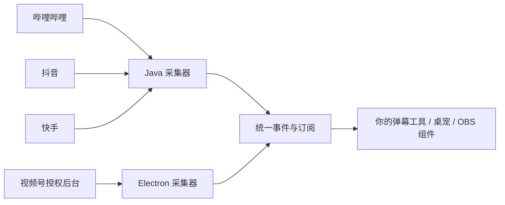

# FurryUP LiveConnect

[](https://github.com/frostynight-furry/furryup-live-connect/actions/workflows/test.yml)
[](LICENSE)
[](package.json)

**为开发者提供 B站、抖音、快手、视频号四平台直播互动采集能力。** 用统一事件构建自己的弹幕工具、互动桌宠、OBS 组件和定制直播工具箱。

Open-source livestream event adapters for Bilibili, Douyin, Kuaishou and WeChat Channels, with a shared Node.js event API. MIT licensed.

[FurryUP 官网](https://frostynight.top/furryup) · [FurryUP Studio 下载](https://github.com/frostynight-furry/furryup-studio-releases) · [FurryUP 桌宠](https://github.com/frostynight-furry/furryup-desktop-pet-releases) · [参与贡献](CONTRIBUTING.md)

[English](README.en.md) · [API 文档](docs/API.md) · [排错指南](docs/TROUBLESHOOTING.md) · [路线图](docs/ROADMAP.md) · [应用案例](docs/SHOWCASE.md) · [更新记录](CHANGELOG.md)

版本 `0.2.0`。包含基于 **OrdinaryRoad 1.5.8** 的 Java 采集器、视频号后台采集器、协议适配、统一事件订阅、消息去重、头像缓存与快手资料补全，以及合成数据回归用例。可以独立使用，无需安装 FurryUP Studio 或注册 FurryUP 账号。

本目录通过 Maven 使用 OrdinaryRoad 已发布的三个模块，**没有复制完整 OrdinaryRoad 项目，也不是它的官方维护仓库**。FurryUP Studio 主程序、插件管理器、账户服务、直播助手、弹幕气泡和礼物特效不在拆分范围内。

## 先跑一个离线示例

安装 Node.js 22.12+ 后执行以下命令。这个示例不需要 Java、Electron、账号或直播间，也不连接平台：

```sh
git clone https://github.com/frostynight-furry/furryup-live-connect.git
cd furryup-live-connect
npm run demo
```

你会看到四个平台的**合成弹幕和礼物**进入同一个订阅接口，以及重复消息过滤、礼物增量累计的结果。输出明确标记为演示数据。它用于理解接入方式，不能证明某个真实房间当前可连接。

| 接下来要做什么 | 入口 |
| --- | --- |
| 将事件接入自己的工具 | [API 文档](docs/API.md)，`require('./core/index.cjs')` |
| 连接 B站 / 抖音 / 快手 | 下方“三平台 Java 采集”，或 `npm run start:multi` |
| 连接自己的视频号后台 | 下方“视频号 Electron 示例” |
| 排查环境、登录、断线和头像 | [排错指南](docs/TROUBLESHOOTING.md) |
| 直接使用完整主播端产品 | [FurryUP Studio](https://github.com/frostynight-furry/furryup-studio-releases) |



## 接入范围

| 平台 | 实现 | 使用条件 |
| --- | --- | --- |
| 哔哩哔哩 | OrdinaryRoad 1.5.8 + 本地事件适配 | 房间号；部分场景需要有效 Cookie |
| 抖音 | OrdinaryRoad 1.5.8 + 登录握手适配 | 房间号及按平台要求提供的 Cookie |
| 快手 | OrdinaryRoad 1.5.8 + 头像与补充事件适配 | 房间号；游客可用性由平台决定 |
| 视频号 | Electron 打开官方直播后台，在本机读取后台收到的消息响应 | 扫码登录自己的账号，并进入自己的直播间 |

四种接入方式覆盖以上四个平台，不代表全平台支持。它们是社区协议适配，不是平台官方开放 API；平台变更可能导致失效。视频号不使用 OrdinaryRoad，也不支持任意他人房间号采集。

## 当前数据能力

以下描述源码实现范围。字段受直播间、登录状态和平台推送影响，不承诺每条消息均完整。

| 数据 | B站 | 抖音 | 快手 | 视频号 |
| --- | --- | --- | --- | --- |
| 弹幕、用户 ID / 昵称 | 支持 | 支持 | 支持 | 支持 |
| 用户头像 | 消息字段 / 缓存 | 消息字段 / 缓存 | 消息字段 / 缓存；可选按 ID 查询 | 后台消息字段 / 缓存 |
| 礼物名称、数量 | 支持，含 V2 适配 | 支持，保留 SDK 增量 | 支持，保留 SDK 增量 | 已确认奖励消息；排除连击汇总重复 |
| 礼物图片 | 支持，含 V2 字段 | 取决于推送 | 取决于推送 | 已适配后台礼物目录缩略图；需本次会话收到目录 |
| 礼物价格 | 平台原始单位 | 平台原始单位 | 缺少可靠价格 | 微信豆交易金额，保留原语义 |
| 点赞 | 支持 | 支持 | 支持 | 部分事件只有信号，不是精确次数 |
| 进房 / 关注 | 已适配 | 已适配 | 尚缺可靠事件 | 已适配 |
| 分享 | 已适配 | 已适配 | 已适配分享列表 | 通知不等同于明确分享 |
| 房间统计 | 区分当前在线、累计观看、点赞 | 按已知字段输出 | 仅解析精确整数，排除“万”等缩写 | 后台在线 / 点赞 / 直播状态 |
| 观众列表 | 不提供完整名单 | 部分贡献榜快照，含原始名次和头像 | 部分可见观众快照，含头像；过滤隐藏身份 | 后台当前可见名单；范围不完整 |
| PK | 基础双人 PK：准备、开始、双方比分、结束及对手资料 | 部分双人模式的比分更新、结束比分；区分模糊／相对显示 | 部分状态，非完整比分 | 尚缺可靠解析 |

所有平台均不保证完整在线观众名单、全量历史补拉或断线期间消息恢复。完整 PK 模式和快手进房 / 关注仍需可靠协议证据。B站双方比分保留原始十进制字符串；不根据比分推断最终胜负。视频号目录缺失、过期或图片源不受支持时，礼物仍正常接收。

具体参考项目、待验证项和验收要求见[路线图](docs/ROADMAP.md)。表中新增适配已通过合成数据测试，真实平台覆盖范围仍需授权环境验证；路线图逐项标明已实现和待解决部分。

## 环境与验证

- Node.js 22.12 或更新版本。
- Java 采集器：JDK 21 或更新版本、Maven 3.9 或更新版本；设置 `JAVA_HOME`，并将 Maven 放入 `PATH`。
- 视频号示例：支持 Electron 的桌面系统；依赖固定为 Electron 43.1.1。

```sh
git clone https://github.com/frostynight-furry/furryup-live-connect.git
cd furryup-live-connect
npm run build
npm test
```

`npm run build` 构建 `collector/target/collector.jar` 并下载 Maven 依赖到 `collector/target/lib/`。`npm test` 运行 Node 测试、Java fixture 及源码清单审计。所有测试使用合成数据，不加入真实直播间，也不送礼。Maven 默认会编译 fixture，但不会执行这些 `main` 方法；请运行本仓库的 `npm test` 或 `npm run test:java`。

只验证 Node 核心、视频号解析与采集生命周期，不需要安装 Electron、JDK 或 Maven：

```sh
npm run test:core
npm run test:wechat
```

## 三平台 Java 采集

构建后启动：

```sh
node examples/java-stdin.cjs
```

在标准输入第一行输入 JSON 并回车，例如以下无凭据模板（房间号需替换）：

```json
{"platform":"kuaishou","roomId":"YOUR_ROOM_ID","cookie":""}
```

`platform` 可选 `bilibili`、`douyin`、`kuaishou`。需要登录的场景在调用端从安全存储取得 Cookie，通过进程的 stdin 管道写入；不要放入命令行参数、仓库文件或日志。第一行之后保持 stdin 打开；EOF 或 Ctrl+C 结束采集。不要用立即关闭 stdin 的单次 `echo | ...` 作为持续采集方式。

stdout 为 UTF-8 NDJSON，每行一个对象，`kind` 为 `status`、`diagnostic`、`room-info` 或 `event` 等类型。真实事件在 `event` 字段中，包含 `platform`、`room_id`、`event_type`、用户信息及对应的内容、数量等字段。事件字段随平台而异；接收端应忽略未知字段，按真实 `event_id` / `source_msg_id` 去重。没有消息 ID 的房间统计是快照，不能当作新增互动累计。输出包含直播互动信息，请由接收端自行决定是否保存和展示。

Java 程序禁用了 SDK 自动重连。`examples/java-stdin.cjs` 展示原始进程接口；需要统一订阅和重连时运行 `npm run start:java:subscribe`，同样在 stdin 第一行提供配置并保持输入打开。它使用 `createJavaCollector`，默认对可重试故障等待 3 秒、6 秒，最多重试两次；登录、验证码、限流、离线和已识别的协议错误交由调用方处理，不持续尝试。连接等待上限为 45 秒。`--self-test` 只检查组件加载和内部断言；`--network-self-test` 只检查本地网络选择器，均不等于真实平台连接验证。

### 多平台并行

构建后执行 `npm run start:multi`，在 stdin 第一行输入配置并保持打开：

```json
{"connections":[{"platform":"bilibili","roomId":"YOUR_BILIBILI_ROOM","cookie":""},{"platform":"douyin","roomId":"YOUR_DOUYIN_ROOM","cookie":""},{"platform":"kuaishou","roomId":"YOUR_KUAISHOU_ROOM","cookie":""}]}
```

示例先校验整份配置，再为每个房间启动独立采集器，共用一个事件订阅接口。它只输出平台、房间、类型、数量及受限状态，不输出 Cookie 或弹幕正文；登录凭据应由宿主通过管道传入。EOF / Ctrl+C 会停止所有子进程。视频号需要 Electron 主进程，接法见 [API 文档](docs/API.md)，不能将 `wechat` 填入这个纯 Node 示例冒充连接。

## 视频号 Electron 示例

```sh
npm ci
npm run start:wechat
```

在打开的官方后台窗口扫码，进入自己的直播间。示例将状态、诊断计数及事件写入 stdout。普通互动有 `source_msg_id` 时，示例按房间和消息 ID 在十分钟窗口内去重。关窗或 Ctrl+C 停止采集。

默认示例不保存登录凭据；浏览器分区仅在本次进程内使用，停止时清理。远程后台页面启用沙盒和上下文隔离、关闭 Node 集成，不注入 preload。程序只处理指定官方消息响应地址，不向平台发送聊天或礼物。

嵌入现有 Electron 应用时可使用：

```js
const { WechatCollector } = require('./wechat/wechat-collector.cjs');
const collector = new WechatCollector({
  BrowserWindow, session,
  credentials: { has: () => false, read: () => '', save: () => {}, clear: () => {} }
});
await collector.connect({
  remember: false,
  onState: state => {},
  onEvent: (event, roomId) => {},
  onDiagnostic: metric => {}
});
// 完成后：await collector.stop();
```

`BrowserWindow`、`session` 来自 Electron 主进程。若启用 `remember: true`，调用方须提供同步的 `has/read/save/clear` 凭据存储，妥善加密与管理登录记录；本仓库不提供持久化实现。仅 Cookie 无法保证恢复完整视频号账号选择状态。只有该连接启用 `remember: true` 时，`stop({ preserveSession: true })` 才会保留完整临时会话供同进程复用；`stop()` 会清理。

## 统一事件订阅

`core/` 只依赖 Node.js 内置库。每个连接明确绑定平台与房间，可以同时为四个平台创建独立会话。`openRoom()` 创建数据处理会话；实际网络采集由 Java 或视频号采集器启动。

```js
const { createLiveConnect } = require('./core/index.cjs');
const live = createLiveConnect();
const room = live.openRoom({ platform: 'kuaishou', roomId: 'YOUR_ROOM_ID' });
const unsubscribe = live.subscribe(event => {
  // 将标准事件交给你的工具箱；按业务需要选择保存/展示的字段。
}, { platform: 'kuaishou', eventTypes: ['comment', 'gift'] });

// Java stdout 的 { kind: 'event', event } 或视频号 onEvent：
// room.ingest(message.event);

const unsubscribeAvatars = live.subscribeAvatars(update => {
  // 只更新已有行的头像，不重新触发弹幕/礼物互动。
});
// 完成后：unsubscribe(); unsubscribeAvatars(); room.close(); live.close();
```

可选在快手 `openRoom` 时传入 `kuaishouCookie`，启用同房间可靠用户 ID 的资料查询。默认不读取本机凭据，不查询隐藏身份，不依据昵称匹配。查询限速、超时、负缓存和风控冷却均有上限；关闭房间会取消待处理查询。

`live.history(filters)` 返回整个 hub 共用的最多 100 条内存历史，不包含房间统计、观众列表和 PK 快照。事件以 `platform`、`room_id`、`event_type`、`event_id`、`source_msg_id` 和对应业务字段表达；没有可靠消息 ID 的独立互动不按文本去重。`await live.getAvatar(avatar_id)` 返回已登记头像的 `{ type, body: Buffer }` 或 `null`，下载仅限平台 CDN，不携带登录 Cookie。

结束时先 `await runner.stop()` / `await collector.stop()`，再 `live.close()`。关闭 hub 或 room 只清理事件、头像和房间会话，不会替你停止外部采集器。完整参数、事件语义、回调错误处理及多平台关闭顺序见 [API 文档](docs/API.md)。

`node examples/subscribe.cjs <platform> <roomId>` 从 stdin 接收采集器的 NDJSON，只输出路由、类型和数量，展示如何将采集与业务订阅分开。调用方须保持上游采集进程的 stdin 打开。

## 数据与能力边界

- 快手普通弹幕有时不携带头像。保留同房间同用户的礼物头像缓存，并可通过统一核心选择启用资料查询；隐藏身份不参与补全，仍不能保证每条弹幕都有头像。
- 快手、抖音礼物数量保留 SDK 已计算的增量。视频号仅将确认的奖励消息计为礼物，连击汇总消息不重复计数。视频号部分点赞是信号，不能伪装成精确次数。
- 价格字段保留平台原始单位，不换算成人民币。未知价格、在线人数或动作语义不编造补齐。
- PK 状态和观众列表是按协议证据解析的快照；缺失的倒计时、进房或关注事件不会根据其他快照推断。
- 视频号 `wechat-decoder.cjs` 可单独用于解析已获得的响应，输入上限为 2 MiB；一条损坏互动不应阻止其余有效互动。

## 更新方式

当前依赖固定为 OrdinaryRoad `1.5.8`。运行时不会自动下载并替换采集代码。升级请修改 `collector/pom.xml` 的 `ordinaryroad.version`，重新构建并完成离线测试，再在获授权的直播间验证。GitHub Actions 仅执行离线回归，不会自动升级依赖、连接直播间或发布安装包。

## 许可证与 FurryUP

本仓库自有源码采用 [MIT 许可证](LICENSE)，允许按其条款使用、修改、分发和商用；请保留版权与许可声明。第三方来源和原有许可见 [THIRD_PARTY_NOTICES.md](THIRD_PARTY_NOTICES.md) 及 [licenses/](licenses/)。软件许可不代表平台接口访问授权，也不授予 FurryUP 商标权。

此仓库仅发布独立源码，没有 JRE、依赖 JAR、账户信息、实际直播记录和原产品私有历史。`package.json` 的 `private: true` 只防止误发布到 npm，不改变 GitHub 源码的 MIT 许可。

**想自己开发：** 使用 LiveConnect 接入你的工具箱，欢迎反馈和贡献协议修复。**想直接开播使用：** [FurryUP Studio](https://github.com/frostynight-furry/furryup-studio-releases) 提供完整主播端产品，[FurryUP 桌宠](https://github.com/frostynight-furry/furryup-desktop-pet-releases) 提供桌面陪伴体验。开源底层能力与 FurryUP 产品持续共同迭代。

下面展示 FurryUP Studio 官方下载仓库已公开的工作台界面，使用示例消息；它展示完整产品的应用方式，不是 LiveConnect 附带的界面。图片和品牌不纳入本仓库源码的 MIT 许可。

[](https://github.com/frostynight-furry/furryup-studio-releases#界面预览)

做出了自己的工具？欢迎按[案例提交说明](docs/SHOWCASE.md)提供公开项目链接。我们会区分官方产品和独立社区项目，不将未接入的项目标记为用户案例。
